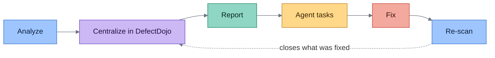

# LabSecurity

> **Analyze. Centralize. Fix. Verify again.**

A free, self-hosted application security lab: one command scans any repository with open-source tools, centralizes the findings in DefectDojo, and lets a coding agent turn them into verifiable tasks.

[Documentation](docs/README.md) · [Try it in minutes](#try-it-in-minutes) · [Architecture](docs/architecture.md) · [Español](README.md)

[](https://github.com/mdesantis1984/labsecurity/actions/workflows/ci.yml) [](LICENSE)   `repository: labsec 0.1.0` · `Opengrep 2.0.0` · `SonarQube 26.11 Community` · `DefectDojo 3.5.200` · 8 integrated tools · 33 own gated rules · ES/EN

## A local lab, not another cloud service

LabSecurity brings open analyzers, a central findings database, and triage rules together in a single `docker compose`. Projects are scanned on your machine; nothing is sent to third parties and the scanned repository is never modified.

| What it provides | Why it matters |
| --- | --- |
| One full lap per project | Opengrep, Gitleaks, Trivy, ESLint, .NET analyzers, SonarQube, and optional ZAP run from one command and answer with a short summary, stable JSON, and an exit code. |
| Centralized findings | DefectDojo keeps one product per repository, deduplicates, and closes what was fixed; what is already triaged is never reviewed twice. |
| Built for agents | The skill and the pre-PR gate give an agent commands, exit codes, and triage rules it can follow without reading raw reports. |
| Local boundary | Ports are published only on `127.0.0.1` and secrets live outside the repository with mode 600. |

## Try it in minutes

Requirements: Docker with the compose plugin (Docker Engine, Docker Desktop, OrbStack, or Colima), `git`, `rsync`, and [`uv`](https://docs.astral.sh/uv/). SonarQube and DefectDojo together need several GB of RAM.

```bash
git clone https://github.com/mdesantis1984/labsecurity.git && cd labsecurity
scripts/init.sh              # creates the credentials (mode 600) without printing them
docker compose up -d --wait  # SonarQube on 127.0.0.1:19000, DefectDojo on 127.0.0.1:19080
bin/scan --bootstrap         # API tokens and first-run setup; safe to repeat
bin/scan --doctor            # every check must be ok
```

The first start pulls images and takes a few minutes. To scan a repository:

```bash
bin/scan ~/code/my-project                  # one full lap: summary and exit code
bin/labsec report my-project                # markdown report, also saved under the data folder
bin/labsec gate ~/code/my-project --json    # pre-PR gate
```

Exit codes: `0` no blocking findings, `1` usage error, `2` open Critical or High findings, `3` lab failure (counts as BLOCKED, never as a pass).

Reports are saved outside the scanned repository and outside LabSecurity, under `reports/<repo>-<hash>/<UTC timestamp>/`:

| System | Data folder |
| --- | --- |
| Linux | `${XDG_DATA_HOME:-~/.local/share}/labsecurity` |
| macOS | `~/Library/Application Support/LabSecurity` |
| Windows (WSL2) | The Linux path inside the distribution; from Windows, `\\wsl$\<distro>\home\<user>\.local\share\labsecurity` |
| Any | `$LABSEC_HOME`, when you set it |

To use it from an agent, install the skill in `skill/labsecurity/` where your agent reads skills and paste one of the two prompts below.

```bash
mkdir -p ~/.claude/skills && ln -s "$PWD/skill/labsecurity" ~/.claude/skills/labsecurity   # Claude Code
mkdir -p ~/.codex/skills  && ln -s "$PWD/skill/labsecurity" ~/.codex/skills/labsecurity    # Codex CLI
mkdir -p ~/.agents/skills && ln -s "$PWD/skill/labsecurity" ~/.agents/skills/labsecurity   # tools that read ~/.agents/skills
```

With Gemini CLI or another agent, copy `skill/labsecurity/SKILL.md` and `references/` into whatever instructions or skills folder it uses. To run the gate before every PR, also paste the snippet from [docs/AGENT-INTEGRATION.md](docs/AGENT-INTEGRATION.md) into the agent's instructions file.

**Prompt 1: install LabSecurity on this machine**

```text
Install LabSecurity on this machine. Clone https://github.com/mdesantis1984/labsecurity.git into a folder I choose
(ask me where), check that Docker with the compose plugin, git, rsync and uv are installed, then run scripts/init.sh,
`docker compose up -d --wait`, `bin/scan --bootstrap` and `bin/scan --doctor` from the clone. Install the skill from
skill/labsecurity into your own skills folder. Do not print credentials, do not change anything outside the clone, your
skills folder and the LabSecurity data folder. Report the result of `bin/scan --doctor`.
```

**Prompt 2: scan this repository and turn the findings into tasks**

```text
Scan this repository with LabSecurity and turn findings into tasks. Use the labsecurity skill: run `labsec gate` on this
repository, triage every blocking finding against the real code (true positive, false positive with a file:line reason,
or "to confirm" when in doubt), never accept a risk, then write the tasks for confirmed true positives with
`labsec tasks` to a markdown file I name. Report the verdict, the number of blocking findings, the false positives with
their reasons, the items to confirm, the tasks created and where the report was saved.
```

## What is available today

| Surface | Actual status |
| --- | --- |
| Linux with Docker Engine | Tested end to end: full lab, laps, gate, triage, and backups. |
| macOS (Docker Desktop, OrbStack, Colima) | Designed and documented; not run yet. Images are native arm64 except the Sonar scanner client (amd64, emulated). |
| Windows with WSL2 | Designed and documented; not run yet. There is no native Windows code. |
| Static analysis | Opengrep (1347 community rules and 33 own), Gitleaks, Trivy, ESLint, and .NET analyzers, with SonarQube for quality. |
| ZAP (DAST) | Only against a loopback URL declared in `.appsec.yml`; authenticated scans are not implemented. |
| SonarQube Community | Analyzes the main branch only and has no taint analysis; Opengrep provides its own taint rules to compensate. |
| Published images | None: everything is built on your machine, because the Opengrep image includes rule packs with restrictive licenses. |

## Designed for trust

- Every published port binds to `127.0.0.1` only, and ZAP scans loopback addresses only.
- A work copy is scanned: the original repository is never modified and reports are stored outside it.
- Credentials are generated locally with mode 600 and are never printed, logged, or included in reports.
- Images, binaries, and rule packs are pinned by digest, commit, or checksum; no third-party code is versioned here.
- An agent never accepts a risk and never marks a false positive without a verifiable `file:line` reason.
- If the lab fails, the gate is BLOCKED; it is never skipped silently.



## Explore the repository

| Path | Responsibility |
| --- | --- |
| `labsec/` | Python CLI package: full lap, gate, triage, reports, and tasks. |
| `bin/` | `scan` and `labsec` launchers. |
| `compose.yaml` | The whole lab: SonarQube, DefectDojo, their databases, and the scanners by profile. |
| `docker/` | Build recipes for the Opengrep, ESLint, .NET analyzers, and ZAP images. |
| `rules/` | Own Opengrep rules: gated and opt-in (`rules/optin/`). |
| `config/` | Own Gitleaks rules. |
| `skill/labsecurity/` | Portable agent skill. |
| `scripts/` | Initialization, backups, and pull request policy validation. |
| `systemd/` | Optional backup timer. |
| `tests/` | Unit tests, rule fixtures, and integration tests against a running lab. |
| `docs/` | CLI reference, rules, platforms, backups, and architecture. |
| `.github/` | Issues, CI, and repository governance. |

The [documentation guide](docs/README.md) shows where each topic lives. Before contributing, read [`CONTRIBUTING.md`](CONTRIBUTING.md), [`SECURITY.md`](SECURITY.md), and the [architecture](docs/architecture.md).

## Acknowledgements

LabSecurity builds on open work that deserves explicit credit:

- [SonarQube Community Build](https://docs.sonarsource.com/sonarqube-community-build/) and [DefectDojo](https://github.com/DefectDojo/django-DefectDojo) provide quality analysis and the central findings store.
- [Opengrep](https://github.com/opengrep/opengrep) runs the taint-aware SAST; its community rules come from [opengrep-rules](https://github.com/opengrep/opengrep-rules), [GitLab sast-rules](https://gitlab.com/gitlab-org/security-products/sast-rules), and [Trail of Bits semgrep-rules](https://github.com/trailofbits/semgrep-rules).
- [Gitleaks](https://github.com/gitleaks/gitleaks), [Trivy](https://github.com/aquasecurity/trivy), and [OWASP ZAP](https://www.zaproxy.org) cover secrets, dependencies and configuration, and dynamic analysis.
- [Security Code Scan](https://github.com/security-code-scan/security-code-scan), [Meziantou.Analyzer](https://github.com/meziantou/Meziantou.Analyzer), and [Roslynator](https://github.com/dotnet/roslynator) strengthen C# analysis; [eslint-plugin-security](https://github.com/eslint-community/eslint-plugin-security), [eslint-plugin-no-unsanitized](https://github.com/mozilla/eslint-plugin-no-unsanitized), [typescript-eslint](https://typescript-eslint.io), and [angular-eslint](https://github.com/angular-eslint/angular-eslint) do the same for TypeScript and Angular.
- [OWASP](https://owasp.org) (Top 10, ASVS, and Cheat Sheets) and [CWE](https://cwe.mitre.org) underpin the own rules, together with public Microsoft and Cloudflare documentation.
- Docker, Python, uv, PostgreSQL, Valkey, and GitHub Actions make the development and delivery chain possible.

LabSecurity is not affiliated with or endorsed by any of these projects, and their trademarks belong to their owners. Applicable licenses are listed in [`THIRD_PARTY_NOTICES.md`](THIRD_PARTY_NOTICES.md); these acknowledgements do not replace their legal texts.

## Contribute

Contributions are welcome when they preserve local-only operation, the safety of the scanned repository, and executable evidence. Start with an [issue](https://github.com/mdesantis1984/labsecurity/issues) and follow [`CONTRIBUTING.md`](CONTRIBUTING.md). LabSecurity is distributed under the [Apache 2.0](LICENSE) license.
