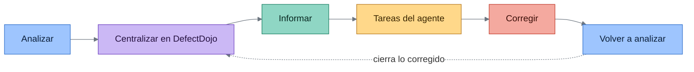

# LabSecurity

> **Analiza. Centraliza. Corrige. Vuelve a verificar.**

Laboratorio de seguridad de aplicaciones autoalojado y gratuito: una sola orden analiza cualquier repositorio con herramientas abiertas, centraliza los hallazgos en DefectDojo y deja que un agente de código los convierta en tareas verificables.

[Documentación](docs/README.md) · [Probarlo en minutos](#probarlo-en-minutos) · [Arquitectura](docs/architecture.md) · [English](README.en.md)

[](https://github.com/mdesantis1984/labsecurity/actions/workflows/ci.yml) [](LICENSE)   `repositorio: labsec 0.1.0` · `Opengrep 2.0.0` · `SonarQube 26.11 Community` · `DefectDojo 3.5.200` · 8 herramientas integradas · 33 reglas propias bloqueantes · ES/EN

## Un laboratorio local, no otro servicio en la nube

LabSecurity reúne analizadores abiertos, una base central de hallazgos y las reglas de triaje en un único `docker compose`. Los proyectos se analizan en tu máquina; no se envía nada a terceros y el repositorio analizado nunca se modifica.

| Lo que aporta | Por qué importa |
| --- | --- |
| Una vuelta completa por proyecto | Opengrep, Gitleaks, Trivy, ESLint, analizadores .NET, SonarQube y ZAP opcional se ejecutan con una orden y responden con resumen corto, JSON estable y código de salida. |
| Hallazgos centralizados | DefectDojo guarda un producto por repositorio, deduplica y cierra lo corregido; lo ya clasificado no se revisa dos veces. |
| Pensado para agentes | La skill y la compuerta previa al PR dan comandos, códigos de salida y reglas de triaje que un agente puede seguir sin leer informes crudos. |
| Frontera local | Los puertos se publican sólo en `127.0.0.1` y los secretos viven fuera del repositorio con permisos 600. |

## Probarlo en minutos

Requisitos: Docker con el plugin compose (Docker Engine, Docker Desktop, OrbStack o Colima), `git`, `rsync` y [`uv`](https://docs.astral.sh/uv/). SonarQube y DefectDojo juntos necesitan varios GB de RAM.

```bash
git clone https://github.com/mdesantis1984/labsecurity.git && cd labsecurity
scripts/init.sh              # genera las credenciales (modo 600) sin mostrarlas
docker compose up -d --wait  # SonarQube en 127.0.0.1:19000, DefectDojo en 127.0.0.1:19080
bin/scan --bootstrap         # tokens de API y configuración inicial; se puede repetir
bin/scan --doctor            # todas las comprobaciones deben salir ok
```

La primera vez se descargan las imágenes y tarda unos minutos. Para analizar un repositorio:

```bash
bin/scan ~/code/mi-proyecto                  # una vuelta completa: resumen y código de salida
bin/labsec report mi-proyecto                # informe en markdown, guardado en la carpeta de datos
bin/labsec gate ~/code/mi-proyecto --json    # compuerta previa a un PR
```

Códigos de salida: `0` sin hallazgos bloqueantes, `1` uso incorrecto, `2` Critical o High abiertos, `3` fallo del laboratorio (cuenta como BLOQUEADO, nunca como aprobado).

Los informes se guardan fuera del repositorio analizado y de LabSecurity, bajo `reports/<repo>-<hash>/<marca de tiempo UTC>/`:

| Sistema | Carpeta de datos |
| --- | --- |
| Linux | `${XDG_DATA_HOME:-~/.local/share}/labsecurity` |
| macOS | `~/Library/Application Support/LabSecurity` |
| Windows (WSL2) | La ruta de Linux dentro de la distribución; desde Windows, `\\wsl$\<distro>\home\<usuario>\.local\share\labsecurity` |
| Cualquiera | `$LABSEC_HOME`, si lo defines |

Para usarlo desde un agente, instala la skill de `skill/labsecurity/` donde el agente lea sus skills y pega uno de los dos prompts siguientes.

```bash
mkdir -p ~/.claude/skills && ln -s "$PWD/skill/labsecurity" ~/.claude/skills/labsecurity   # Claude Code
mkdir -p ~/.codex/skills  && ln -s "$PWD/skill/labsecurity" ~/.codex/skills/labsecurity    # Codex CLI
mkdir -p ~/.agents/skills && ln -s "$PWD/skill/labsecurity" ~/.agents/skills/labsecurity   # herramientas que leen ~/.agents/skills
```

Con Gemini CLI u otro agente, copia `skill/labsecurity/SKILL.md` y `references/` a la carpeta de instrucciones o skills que use. Para ejecutar la compuerta antes de cada PR, pega además el fragmento de [docs/AGENT-INTEGRATION.md](docs/AGENT-INTEGRATION.md) en el archivo de instrucciones del agente.

**Prompt 1: instalar LabSecurity en esta máquina**

```text
Instala LabSecurity en esta máquina. Clona https://github.com/mdesantis1984/labsecurity.git en una carpeta que yo elija
(pregúntame dónde), comprueba que están instalados Docker con el plugin compose, git, rsync y uv, y ejecuta desde el
clon scripts/init.sh, `docker compose up -d --wait`, `bin/scan --bootstrap` y `bin/scan --doctor`. Instala la skill de
skill/labsecurity en tu propia carpeta de skills. No muestres credenciales y no cambies nada fuera del clon, de tu
carpeta de skills y de la carpeta de datos de LabSecurity. Informa el resultado de `bin/scan --doctor`.
```

**Prompt 2: analizar este repositorio y convertir los hallazgos en tareas**

```text
Analiza este repositorio con LabSecurity y convierte los hallazgos en tareas. Usa la skill labsecurity: ejecuta
`labsec gate` sobre este repositorio, clasifica cada hallazgo bloqueante contra el código real (verdadero positivo,
falso positivo con un motivo archivo:línea, o "a confirmar" si hay dudas), nunca aceptes un riesgo y escribe las tareas
de los verdaderos positivos con `labsec tasks` en el archivo markdown que yo indique. Informa el veredicto, la cantidad
de hallazgos bloqueantes, los falsos positivos con sus motivos, los puntos a confirmar, las tareas creadas y dónde se
guardó el informe.
```

## Qué está disponible hoy

| Superficie | Estado real |
| --- | --- |
| Linux con Docker Engine | Probado de extremo a extremo: laboratorio completo, vueltas, compuerta, triaje y copias de seguridad. |
| macOS (Docker Desktop, OrbStack, Colima) | Diseñado y documentado; todavía no se ha ejecutado. Las imágenes son arm64 nativas salvo el cliente del escáner de Sonar (amd64 emulado). |
| Windows con WSL2 | Diseñado y documentado; todavía no se ha ejecutado. No existe código nativo de Windows. |
| Análisis estático | Opengrep (1347 reglas comunitarias y 33 propias), Gitleaks, Trivy, ESLint y analizadores .NET, con SonarQube para calidad. |
| ZAP (DAST) | Sólo contra una URL de bucle local declarada en `.appsec.yml`; los análisis autenticados no están implementados. |
| SonarQube Community | Sólo analiza la rama principal y no incluye análisis de taint; Opengrep aporta taint propio como compensación. |
| Imágenes publicadas | Ninguna: todo se construye en tu máquina, porque la imagen de Opengrep incluye paquetes de reglas con licencias restrictivas. |

## Diseñado para poder confiar

- Todos los puertos publicados se enlazan sólo a `127.0.0.1` y ZAP sólo analiza direcciones de bucle local.
- Se analiza una copia de trabajo: el repositorio original nunca se modifica y los informes se guardan fuera de él.
- Las credenciales se generan en local con permisos 600 y no se imprimen, registran ni incluyen en informes.
- Imágenes, binarios y paquetes de reglas se fijan por digest, commit o suma de verificación; ningún código de terceros se versiona aquí.
- Un agente nunca acepta un riesgo ni marca un falso positivo sin un motivo verificable `archivo:línea`.
- Si el laboratorio falla, la compuerta queda BLOQUEADA; nunca se omite en silencio.



## Recorrer el repositorio

| Ruta | Responsabilidad |
| --- | --- |
| `labsec/` | Paquete Python de la CLI: vuelta completa, compuerta, triaje, informes y tareas. |
| `bin/` | Lanzadores `scan` y `labsec`. |
| `compose.yaml` | Laboratorio completo: SonarQube, DefectDojo, sus bases de datos y los escáneres por perfil. |
| `docker/` | Recetas de las imágenes de Opengrep, ESLint, analizadores .NET y ZAP. |
| `rules/` | Reglas propias de Opengrep: bloqueantes y opcionales (`rules/optin/`). |
| `config/` | Reglas propias de Gitleaks. |
| `skill/labsecurity/` | Skill portable para agentes. |
| `scripts/` | Inicialización, copias de seguridad y validación de políticas de PR. |
| `systemd/` | Temporizador opcional de copias de seguridad. |
| `tests/` | Pruebas unitarias, fixtures de reglas y pruebas de integración con el laboratorio activo. |
| `docs/` | Referencia de la CLI, reglas, plataformas, copias de seguridad y arquitectura. |
| `.github/` | Issues, CI y gobierno del repositorio. |

La [guía de documentación](docs/README.md) indica dónde está cada tema. Antes de contribuir, consulta [`CONTRIBUTING.md`](CONTRIBUTING.md), [`SECURITY.md`](SECURITY.md) y la [arquitectura](docs/architecture.md).

## Agradecimientos

LabSecurity se construye sobre trabajo abierto que merece crédito explícito:

- [SonarQube Community Build](https://docs.sonarsource.com/sonarqube-community-build/) y [DefectDojo](https://github.com/DefectDojo/django-DefectDojo) aportan el análisis de calidad y la centralización de hallazgos.
- [Opengrep](https://github.com/opengrep/opengrep) ejecuta el análisis SAST con taint; sus reglas comunitarias vienen de [opengrep-rules](https://github.com/opengrep/opengrep-rules), [GitLab sast-rules](https://gitlab.com/gitlab-org/security-products/sast-rules) y [Trail of Bits semgrep-rules](https://github.com/trailofbits/semgrep-rules).
- [Gitleaks](https://github.com/gitleaks/gitleaks), [Trivy](https://github.com/aquasecurity/trivy) y [OWASP ZAP](https://www.zaproxy.org) cubren secretos, dependencias y configuración, y análisis dinámico.
- [Security Code Scan](https://github.com/security-code-scan/security-code-scan), [Meziantou.Analyzer](https://github.com/meziantou/Meziantou.Analyzer) y [Roslynator](https://github.com/dotnet/roslynator) refuerzan el análisis de C#; [eslint-plugin-security](https://github.com/eslint-community/eslint-plugin-security), [eslint-plugin-no-unsanitized](https://github.com/mozilla/eslint-plugin-no-unsanitized), [typescript-eslint](https://typescript-eslint.io) y [angular-eslint](https://github.com/angular-eslint/angular-eslint) hacen lo propio con TypeScript y Angular.
- [OWASP](https://owasp.org) (Top 10, ASVS y Cheat Sheets) y [CWE](https://cwe.mitre.org) sustentan las reglas propias junto con la documentación pública de Microsoft y Cloudflare.
- Docker, Python, uv, PostgreSQL, Valkey y GitHub Actions hacen posible la cadena de desarrollo y entrega.

LabSecurity no está afiliado a ninguno de estos proyectos ni cuenta con su respaldo, y sus marcas pertenecen a sus titulares. Las licencias aplicables están en [`THIRD_PARTY_NOTICES.md`](THIRD_PARTY_NOTICES.md); este agradecimiento no reemplaza sus textos legales.

## Participar

Las contribuciones son bienvenidas cuando preservan el uso local, la seguridad del repositorio analizado y la evidencia ejecutable. Comienza por un [issue](https://github.com/mdesantis1984/labsecurity/issues) y sigue el flujo de [`CONTRIBUTING.md`](CONTRIBUTING.md). LabSecurity se distribuye bajo la licencia [Apache 2.0](LICENSE).
