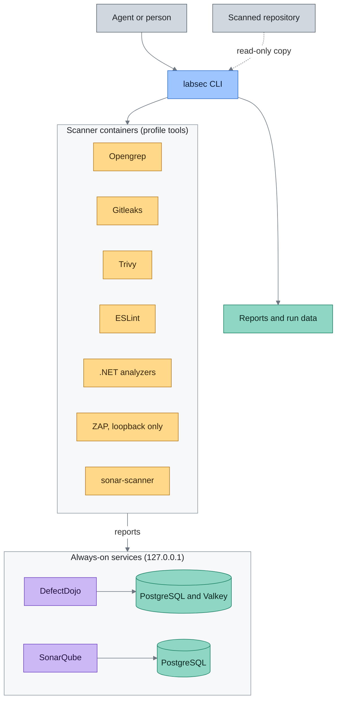
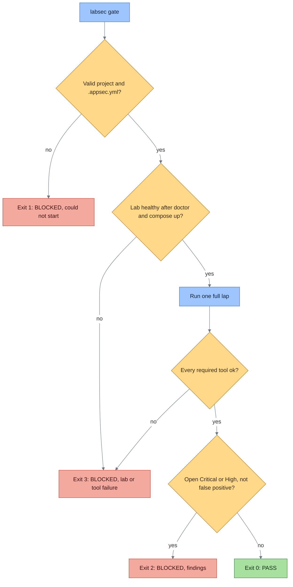

# LabSecurity repository boundary

LabSecurity is a local AppSec lab: it orchestrates open-source scanners, stores their findings in DefectDojo, and answers with a summary, a JSON document, and an exit code. The scanned repositories and the upstream tools are separate systems; LabSecurity never modifies the former and never forks the latter.

## Ownership

| Area | LabSecurity owns | Upstream tools and scanned projects own |
| --- | --- | --- |
| Orchestration | The `labsec` CLI, the lap pipeline, the gate, triage, reports, and task generation | Nothing: scanned projects are read-only inputs |
| Rules | Own Opengrep and Gitleaks rules, Python checks, and the severity mapping | Third-party rule packs, downloaded at build time and never vendored |
| Findings | Product and engagement naming, deduplication settings, triage state transitions | The scanners' detection logic and the DefectDojo data model |
| Deployment | `compose.yaml`, image recipes, pinned digests, backups | The images and binaries themselves, each under its own license |
| Agent contract | The skill, the exit codes, and the policy that an agent never accepts a risk | The agent's own configuration and the project's task format |

## Components



## Dependency direction

```text
Scanned repository (read-only) -> LabSecurity work copy -> scanners -> DefectDojo -> summary, report, tasks
```

LabSecurity must never write into a scanned repository, and reports are refused inside it. Upstream images are consumed by digest; nothing from them is copied into this repository.

## One lap

```mermaid
%%{init: {"theme": "base", "themeVariables": {"fontFamily": "ui-sans-serif, system-ui, sans-serif", "lineColor": "#6e7781", "textColor": "#1f2328", "edgeLabelBackground": "#ffffff"}}}%%
flowchart LR
  A["Detect languages"] --> B["Lock and copy"]
  B --> C["Run scanners"]
  C --> D["Import to DefectDojo"]
  D --> E["Summarize"]
  E --> F["Save report"]

  classDef prep fill:#9ec5fe,stroke:#2f6fcb,color:#0b1f3a
  classDef run fill:#ffd88a,stroke:#b7791f,color:#3a2600
  classDef store fill:#cbb8f5,stroke:#6f42c1,color:#24103f
  classDef out fill:#8fd6c4,stroke:#1a7f64,color:#06261f
  class A,B prep
  class C run
  class D store
  class E,F out
```



The lap reads `.appsec.yml`, takes the heavy-analysis lock so two heavy analyses never run at once (a second lap fails with exit code 3 instead of competing for memory), scans a work copy, waits for DefectDojo deduplication to settle, and saves the report outside the repositories. Each repository is one DefectDojo product; each run and branch is one engagement.

## Gate decision



A failure (3) always wins over findings (2): an incomplete analysis is never reported as a pass. Details and JSON schemas are in [GATE.md](GATE.md) and [CLI.md](CLI.md).

## Triage cycle

- `labsec findings` reads the DefectDojo API only; agents never read raw reports.
- A false positive needs a verifiable `file:line` reason and stays listed so a person can review and revert it.
- Accepting a risk is a human decision: no code path in LabSecurity sets `risk_accepted`, and a test enforces it.
- A task is closed only after a new lap shows the finding as mitigated in DefectDojo, with the fix commit as evidence.

## Delivery boundary

LabSecurity publishes no package and no image. The lab is built and run on the user's machine from `compose.yaml` and the Dockerfiles under `docker/`; the Opengrep image bundles third-party rule packs with restrictive licenses and must not be pushed to a registry (see [THIRD_PARTY_NOTICES.md](../THIRD_PARTY_NOTICES.md)). Every published port binds to `127.0.0.1`, services restart automatically with Docker, and credentials never enter the repository, logs, or reports.
